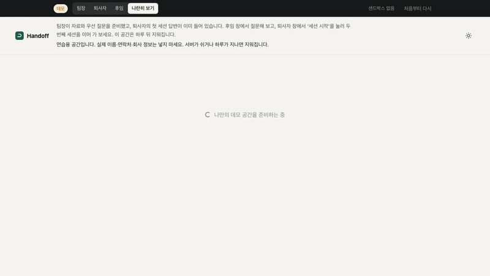
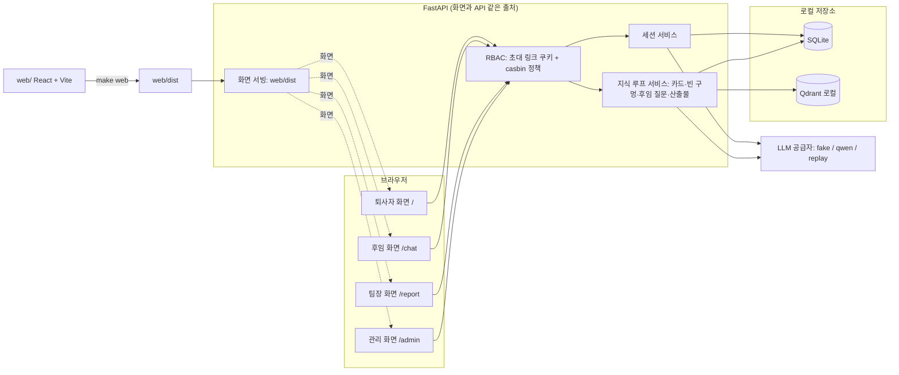

# 핸드오프 (Handoff)

퇴사가 정해진 사람이 마지막 몇 주 동안 매일 15분, 화면이 던지는 질문에 답하기만 하면 그 사람의 업무 지식이 후임이 물어볼 수 있는 인수인계 기록으로 남습니다. 후임은 문서를 뒤지는 대신 질문하고 근거와 함께 답을 받으며, 기록에 없는 질문은 다음 날 퇴사자에게 다시 돌아갑니다. 팀장은 어느 업무가 아직 비어 있는지만 보고, 답변 내용을 들여다보거나 사람을 평가하지 않습니다.

데모: 배포 대기 (로컬은 make demo)



[90초 영상](docs/media/demo.mp4) · 팀장·퇴사자·후임 화면을 한 페이지에서 나란히 보는 데모

## 바로 해 보기
[uv](https://docs.astral.sh/uv/) 와 Node.js 24(npm 포함)가 있으면 된다. API 키는 필요 없다 (녹화된 답을 재생한다).
```bash
uv sync
make demo        # 웹 화면을 빌드한 뒤 "데모 주소: http://localhost:8780/demo" 가 뜨면 브라우저로 연다
make try         # 인증을 켠 실제 흐름: 관리자·퇴사자·후임·팀장 창 4개가 따로 열린다 (Ctrl+C 로 종료)
```
`make try` 의 네 창은 역할마다 쿠키가 분리돼 있어서, 링크를 다른 곳에서 열려면 역할마다 다른 브라우저(또는 프로필)를 쓴다. 처음이면 `uv run playwright install chromium` 을 먼저 실행하고, 포트·데이터 폴더는 `make try TRY_ARGS="--port 8781 --data-dir ./data/try"` 처럼 바꾼다.
`make demo` 는 먼저 `make web` 으로 `web/` 의 화면을 빌드한다. 이미 최신이면 빌드를 건너뛴다.
`/demo` 를 열면 바로 나만의 연습 공간이 생기고 퇴사자의 첫 세션 답변까지 기록돼 있다(퇴사자 창에는 열린 세션이 없어 `세션 시작` 을 누르면 두 번째 세션이 이어진다). 이어서 할 일은 [시연 시나리오](docs/demo-scenario.md) 11단계부터.

## 실제 사용 흐름
1. 관리자가 관리 화면(`/admin`)에서 퇴사자를 별칭으로 등록한다.
2. 퇴사자·후임·팀장용 초대 링크 3개를 만든다.
3. 담당자가 링크를 각자에게 직접 전달한다 (이 서비스는 메일을 보내지 않는다).
4. 퇴사자는 매일 15분 질문에 답하고, 팀장은 빈 업무 영역 리포트를 보고, 후임은 기록에 질문한다.

## 구조
화면은 `web/` 의 React 앱이다. `make web` 이 `web/dist` 로 빌드하면 API 서버가 같은 출처에서 그 파일을 그대로 내준다. 별도 프론트 서버나 CORS 설정이 없다.


## 철학
인수인계 문서는 쓰는 사람이 뭘 아는지 모른 채 쓰인다. 질문하는 쪽이 모르는 걸 끌어내야 지식이 남는다.

## 문제
- 퇴사자는 마지막 2주를 "문서 한 장" 쓰는 데 쓰고, 그 문서는 아무도 안 읽는다
- 정작 중요한 건 "왜 그렇게 했는지", "어디가 함정인지", "누구한테 물어야 하는지"인데 문서에 없다
- 후임은 입사 후 같은 실수를 반복한다

## 방향
- 퇴사 확정일부터 매일 15분, 질문에 퇴사자가 답한다. 질문은 담당 시스템·반복 업무·사고 이력·관계자 네 축으로 깊어진다
- 답변은 자동으로 정리돼 검색 가능한 지식베이스가 되고, 후임은 문서를 읽는 대신 거기에 질문한다
- 빈 구멍(답 없는 영역)을 팀장에게 알려 퇴사 전에 채운다

## 하지 않는 것
- 감시·평가 용도 (팀장은 답변 원문·세션 요약·개인별 깊이를 볼 수 없다)
- 코드·시스템 자동 문서화

## MVP
- 질문 트리 1개 직군(백엔드 개발자), 텍스트 입력 (음성은 다음)
- 10세션 후 지식베이스에 질문 20개를 던져 답변 품질 확인 → 결과는 [사용 문서의 품질 평가](docs/usage.md#품질-평가)

## 실행 방법
환경변수 전체 표, API 예시, 품질 평가 수치는 [docs/usage.md](docs/usage.md) 에 있다. 설계 결정은 [docs/decisions.md](docs/decisions.md), 공개 배포는 [docs/deploy.md](docs/deploy.md), 완성 모습은 [docs/vision.md](docs/vision.md).

### 요구사항과 설치
- [uv](https://docs.astral.sh/uv/) 와 Node.js 24(npm 포함)가 필요하다. Python 3.12는 uv가 설치한다. `uv sync` 후 `make web` 으로 화면을 빌드한다(`web/` 에서 `npm ci`·`npm run build`, 최신이면 건너뜀).
- 실제 공급자(qwen)로 돌릴 때만 OpenAI 호환 Qwen API 키가 필요하다. fake 모드와 데모 모드(replay)는 키 없이 돈다.
- 설정을 바꾸려면 `cp .env.example .env` 후 값을 수정하고 명령에 `--env-file .env` 를 붙인다 (앱은 `.env` 를 직접 읽지 않는다). 키는 `.env` 에만 두고 커밋하지 않는다.

### 서버 실행
fake 공급자 (키 불필요):
```bash
make web
uv run uvicorn handoff.main:create_app --factory --port 8780
```
`web/dist` 가 있으면 `/` 부터 새 화면이 뜬다. 빌드가 없거나 `HANDOFF_WEB_DIST=off` 를 주면 `src/handoff/static/` 의 옛 화면으로 돌아간다.

qwen 공급자 (`.env` 에 `HANDOFF_PROVIDER=qwen`, `HANDOFF_LLM_API_KEY` 설정):
```bash
uv run --env-file .env uvicorn handoff.main:create_app --factory --port 8780
```
준비 확인: `curl -sf http://localhost:8780/health` → `{"status":"ok"}`. 인증 없이 띄우기(평가 도구, API 예시용)는 앞에 `HANDOFF_AUTH=off` 를 붙인다.

이번에 생긴 설정 세 가지(나머지 환경변수는 [docs/usage.md](docs/usage.md)):
- `HANDOFF_WEB_DIST`: 서빙할 빌드 폴더. 기본은 저장소의 `web/dist`, `off` 면 옛 화면.
- `HANDOFF_TRUSTED_PROXIES`: `X-Forwarded-For` 를 믿을 상대(쉼표 목록, `*`·IP·CIDR·호스트). 기본은 빈 값이라 헤더를 무시하고 접속 주소로 데모 요청 수를 센다. `handoff-demo --public`(Docker)은 기본 `*`. 리버스 프록시를 앞에 두면 그 주소(예: `localhost`)를 준다.
- `HANDOFF_API_DOCS`: `/docs`·`/redoc`·`/openapi.json` 을 열지(`on`/`off`). 기본은 인증을 따라 인증 켬이면 닫히고 인증 끔이면 열린다.

데모 모드를 `make demo` 대신 `uv run uvicorn …` 으로 직접 띄울 때는 `--no-proxy-headers` 를 붙인다. uvicorn 은 기본으로 루프백 상대의 `X-Forwarded-For` 를 믿어 접속 주소를 바꿔 버리므로, 그대로 두면 헤더를 바꿔 요청 수 제한을 피할 수 있다(`FORWARDED_ALLOW_IPS` 를 실제 프록시로 좁혀도 된다).

화면을 고치며 개발할 때는 Vite 개발 서버(`http://localhost:5173`)가 API 경로를 8780 으로 넘긴다. 실행 방법은 [web/README.md](web/README.md).

### 역할과 초대 링크
서버는 기본으로 인증을 켠 채 뜬다 (`HANDOFF_AUTH=on`). 계정·비밀번호·이름·이메일은 받지 않는다. 사람마다 역할 하나와 퇴사자 id 하나를 담은 서명된 초대 링크를 만들어 건네면, 링크를 연 브라우저에 로그인 쿠키(`handoff_session`, HttpOnly, 7일)가 붙고 그 역할의 화면으로 이동한다.

관리 화면으로 링크 만들기 (실제 사용):
1. 첫 관리자 링크를 명령으로 만든다. 서버와 같은 `HANDOFF_DATA_DIR`·`HANDOFF_AUTH_SECRET` 으로 실행한다.
   ```bash
   uv run python -m handoff.rbac.cli admin
   ```
2. 출력된 링크를 열면 관리 화면(`/admin`, "인수인계 관리")으로 간다. 퇴사자를 별칭으로 등록하고(실명·이메일 금지), 목록에서 퇴사자·후임·팀장 링크를 만들어 복사한다.
3. 링크는 담당자가 직접 전달한다. 링크 앞부분 주소는 `HANDOFF_PUBLIC_URL` 이 있으면 그 값, 없으면 요청이 들어온 주소다.
- 관리자(`admin`)는 링크 발급과 퇴사자 등록만 한다. 퇴사자 데이터(세션·카드·리포트)는 볼 수 없다. 팀장은 링크를 만들 수 없다.

명령으로 직접 만들기 (시연·스크립트용):
```bash
uv run python -m handoff.rbac.cli invite --role leaver --leaver default
uv run python -m handoff.rbac.cli invite --role successor --leaver default
uv run python -m handoff.rbac.cli invite --role manager --leaver default
```
- `--role` 은 `leaver`(퇴사자)·`successor`(후임)·`manager`(팀장), `--leaver` 는 `^[a-z0-9_-]{1,40}$`. 다른 주소로 띄웠으면 `--base-url` 을 준다 (기본 `http://localhost:8780`).
- 출력은 `http://localhost:8780/auth/accept?token=...` 한 줄이다. 72시간(`HANDOFF_INVITE_TTL_HOURS`) 동안 여러 번 쓸 수 있고 개별 폐기는 없다. 전부 무효로 하려면 `auth_secret` 파일을 지우거나 `HANDOFF_AUTH_SECRET` 을 바꾸고 서버를 재시작한다.
- 지금 역할 확인 `GET /auth/me`, 로그아웃 `POST /auth/logout`.
- 한 브라우저는 로그인 역할을 하나만 가진다. 링크를 여러 개 열면 마지막에 연 링크의 역할이 남는다.
- 같은 브라우저 창들은 쿠키를 공유한다. 세 역할을 한 번에 보려면 창 3개를 서로 다른 쿠키 저장소로 연다 (일반 창 / 시크릿 창 / 다른 브라우저).
- 로그인 쿠키는 localhost 시연용으로 HTTPS 전용 표시 없이 나간다. 실제 운영은 HTTPS 뒤에 두는 것을 전제로 한다.
- 처음부터 끝까지 따라 하는 3역할 시연 순서는 [docs/demo-scenario.md](docs/demo-scenario.md) 에 있다.

역할별로 열리는 범위 (정책 파일 `src/handoff/rbac/policy.csv`, 정책에 없는 경로는 거부):

| 역할 | 할 수 있는 것 | 할 수 없는 것 |
|------|---------------|---------------|
| 퇴사자 | 자기 세션 시작·답변·종료, 자기 커버리지·카드·자료 목록·산출물 보기, 답변 깊이·암묵지 판정 | 후임 질문, 다른 퇴사자 데이터 |
| 후임 | 지식베이스 질문(`/kb/ask`)·울타리 질문, 카드·at-risk·산출물 보기, 장애 훈련 | 세션 답변 원문·요약, 큐 조작, 다른 퇴사자 지식 |
| 관리자 | 퇴사자 등록·목록, 역할별 초대 링크 발급(`/admin/*`) | 퇴사자 데이터 전부 |
| 팀장 | 커버리지·빈 구멍·모르는 영역·질문 큐·자료 목록·at-risk·산출물 보기, 자료 적재·질문 생성·사전 부검 질문·우선 질문 지정·산출물 생성 | **답변 원문·세션 요약·답변별 깊이·카드 목록·훈련 결과** (감시·평가에 쓰이지 않게 막는다) |

- 모든 역할은 초대에 적힌 퇴사자 id 의 데이터만 본다. 경로·쿼리·본문의 `leaver` 나 세션·훈련의 퇴사자가 다르면 403 이고, 본문을 읽을 수 없으면 거부한다(fail-closed).
- 지식베이스 검색은 퇴사자 id 로 걸러진다. 답과 발췌의 이메일·전화번호는 저장 전과 응답 직전에 가린다.
- 옛 API `POST /kb/query` 는 인증을 켜면 모든 역할에 403 이다. 후임 채팅은 `/kb/ask` 를 쓴다.

### 화면
| 주소 | 사용자 | 내용 |
|------|--------|------|
| `http://localhost:8780/` | 퇴사자 | 세션 시작, 질문에 답하기(큐에서 온 질문은 출처 표시: 팀장 우선 지정·후임 질문·사전 부검·빈 구멍 확인·업무 자료), 남은 시간, 종료 시 오늘 요약 3줄 |
| `http://localhost:8780/chat` | 후임 | 지식베이스 질문(`/kb/ask`)과 근거, 확실도, 답이 없을 때 "퇴사자에게 질문을 넘겼다" 안내와 먼저 물어볼 역할, "왜 이렇게 돼 있나" 울타리 질문, 인수인계 산출물 보기 |
| `http://localhost:8780/admin` | 관리자 | 퇴사자 등록(별칭), 퇴사자·후임·팀장 초대 링크 만들기·복사 |
| `http://localhost:8780/demo` | 방문자 (데모 모드) | 연습 공간 만들기, 세 역할 화면 나란히 보기, 역할 전환 |
| `http://localhost:8780/intro` | 누구나 | 서비스 소개. 인증 켠 서버에서 로그인 전에 `/` 로 오면 여기로 보낸다 (새 화면 빌드가 있을 때만) |
| `http://localhost:8780/report` | 팀장 | 네 축별 커버리지(큐 질문 답변 수 포함), 비어 있는 주제, 모의 자료 불러오기·자료로 질문 만들기·사전 부검 질문·빈 구멍 다시 찾기·우선 질문 지정, 질문 큐, 빈 구멍, 아무도 확실히 모르는 영역, 산출물 5종 만들기·보기 |

각 화면은 `/auth/me` 로 역할을 확인하고, 로그인 전이면 "초대 링크로 들어와 주세요.", 다른 역할이면 "이 화면을 볼 권한이 없습니다." 를 보여 준다. 퇴사자 id 는 초대 링크에서 온다. 인증을 끈 서버(`HANDOFF_AUTH=off`)에서는 예전처럼 `?leaver=<id>` 로 고른다 (생략 시 `default`).

세션 규칙: 한 세션 15분(`HANDOFF_SESSION_SECONDS`), 마감 판정은 서버가 하고 유예 30초 뒤 답변을 거부한다. 퇴사자당 10회를 넘는 시작은 409로 거부하고, 새 세션을 시작하면 열려 있던 이전 세션은 자동 종료된다. 세션 상태는 SQLite 에 저장돼 서버를 재시작해도 회차·진행 위치·요약이 남는다.

### 테스트
단위 테스트:
```bash
uv run pytest tests/unit -q
```

E2E 테스트 (서버를 테스트가 직접 띄운다, fake 공급자). 새 화면을 검사하는 테스트가 `web/dist` 를 쓰므로 먼저 빌드한다:
```bash
make web
uv run pytest tests/e2e -q
```

### 제약
- 기본 테스트·E2E 는 fake 공급자로 돌아 API 키가 필요 없다. 실제 답변 품질은 qwen 공급자에서만 의미가 있다.
- qwen 공급자는 답변 원문을 외부 API(LLM·임베딩)로 보낸다. 기기 안 처리가 아니다.
- 질문 트리는 백엔드 개발자 직군 1개, 입력은 텍스트만 (음성은 다음 단계).
- 커버리지 리포트는 `/report` 화면과 `GET /coverage` JSON 1장이다. 메일 발송은 하지 않는다. 우선 질문 지정은 2026-10-23 역할 통합에서 `/report` 화면에 붙였다.
- 초대 링크는 메일·메신저로 보내지 않는다. 관리자가 복사해 직접 전달한다.
- 인증은 초대 링크 하나에 역할 하나·퇴사자 하나다. 계정·SSO·초대 1회용·개별 폐기·여러 퇴사자를 보는 팀장은 없다.
- 품질 평가는 규칙 기반이며 LLM 심판을 쓰지 않는다. 평가 데이터는 가상 고정 데이터다.
- 인수인계에 없는 주제의 지어낸 답은 주장 단위 검증으로 qwen 실측 두 회차 모두 0/6 이었다 (검증 전 MVP 는 2/6). 다만 규칙 평가 20문항 기준이고, 검증이 보수적이라 있는 주제도 답하지 않는 경우가 늘었다 (답변 있음 12/20). `HANDOFF_VERIFY_CLAIMS=off` 면 지식베이스 답을 검증 없이 MVP 때처럼 만든다.
