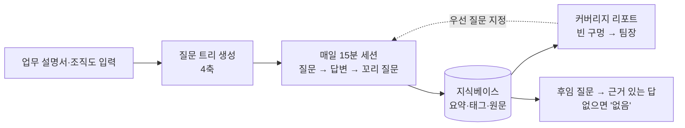
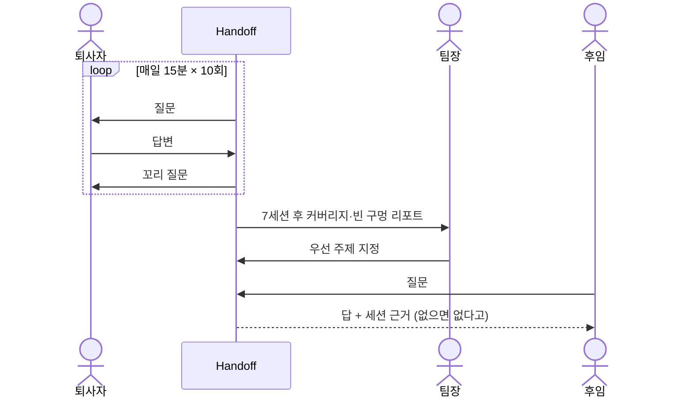

# 핸드오프 (Handoff) — 완성된 모습

> 이 문서는 "어떻게 만들까"가 아니라 "다 만들어졌을 때 사용자가 무엇을 보고 겪는가"를 적는다.
> 내부 구조는 나중에 docs/system-overview.md 와 docs/decisions.md 에서 다룬다.

## 한 문장

퇴사까지 매일 15분, AI가 묻고 퇴사자가 답하면 인수인계 문서 대신 "물어보면 답하는 지식베이스"가 남는다.

## 등장인물

| 역할 | 상황 | 바라는 것 |
|---|---|---|
| 퇴사 예정 백엔드 개발자 (D-14) | 결제 서비스 3년 담당, 문서 쓸 시간도 의욕도 없다 | 15분씩만 말하고 끝내고 싶다 |
| 팀장 | 후임은 2주 뒤 입사 | 뭐가 안 넘어왔는지 미리 알고 싶다 |
| 후임 개발자 (입사 D+1) | 문서 40쪽은 읽어도 머리에 안 남는다 | 막힐 때 바로 물어보고 싶다 |

## 시나리오 1: 퇴사자의 15분

1. 아침에 링크를 연다. 화면에 질문 하나: **"결제 서비스에서 배포가 가장 무서운 부분은 어디인가요? 왜요?"**
2. 타이핑으로 답한다(MVP). 서너 문장 쓰면 꼬리 질문이 온다: "그 설정값을 바꾼 적이 있나요? 그때 무슨 일이 있었죠?"
3. 15분이 되면 "오늘은 여기까지"와 함께 오늘 쌓인 것 요약 3줄, 그리고 커버리지 지도가 한 칸 더 채워진 모습을 본다.
4. 질문은 네 축을 돌아가며 깊어진다: **담당 시스템 · 반복 업무 · 사고 이력 · 관계자**.

## 시나리오 2: 팀장의 빈 구멍 리포트

1. 7세션이 끝난 시점에 팀장에게 메일 한 통: "결제 서비스 인수인계 진행 상황".
2. 네 축별 채워진 정도가 막대로 보이고, 비어 있는 주제가 나열된다: "정산 배치 실패 시 수동 복구 절차: 답변 없음", "외부 PG사 담당자 연락 경로: 답변 없음".
3. 팀장은 퇴사자에게 "이 둘은 꼭 남겨 달라"고 말하고, 다음 세션 질문이 그쪽으로 우선 배정된다.

## 시나리오 3: 후임의 첫 질문

1. 후임이 입사 첫 주에 지식베이스 채팅을 연다. "배포를 왜 금요일에는 안 하나요?"
2. 답: "2025년 3월 금요일 배포 후 정산 배치가 주말 내내 실패한 적이 있어 금요일 배포를 피합니다. 복구는 ... (세션 4, 사고 이력)". 답변 아래에 원 답변 발췌와 세션 날짜가 붙는다.
3. 지식베이스에 없는 질문이면 "이 주제는 인수인계에 없습니다. 팀장 또는 OO 담당자에게 물어보세요"라고 솔직하게 말한다. 지어내지 않는다.

## 화면 스케치

퇴사자 세션 화면:

```
┌─────────────────────────────────────────┐
│ Handoff · 세션 5/10        ⏱ 11:20 남음  │
│ 축: 사고 이력                             │
│                                         │
│ 🤖 결제 서비스에서 배포가 가장 무서운      │
│    부분은 어디인가요? 왜요?               │
│                                         │
│ 👤 정산 배치요. 배포 직후 큐가 밀리면      │
│    새벽 배치가 타임아웃 나요. 작년에...     │
│                                         │
│ 🤖 그때 어떻게 복구했나요? 지금도 같은      │
│    방법이 통하나요?                       │
│                                         │
│ ┌─────────────────────────────┐ [보내기]  │
│ │ 답변 입력...                 │          │
│ └─────────────────────────────┘          │
│ 오늘 쌓인 것: 3항목 · 전체 41항목          │
└─────────────────────────────────────────┘
```

팀장용 커버리지 리포트:

```
 결제 서비스 인수인계 · 세션 7/10 기준

 담당 시스템   ████████░░  8/10 주제
 반복 업무     ██████░░░░  6/10
 사고 이력     █████░░░░░  5/10
 관계자        ███░░░░░░░  3/10   ← 가장 비어 있음

 비어 있는 주제
  · 정산 배치 실패 시 수동 복구 절차
  · 외부 PG사 장애 시 연락 경로
  · 월말 수수료 정산 검증 방법
                          [이 주제 우선 질문하기]
```

후임 채팅:

```
┌─────────────────────────────────────────┐
│ 결제 서비스 지식베이스                     │
│ 👤 배포를 왜 금요일에는 안 하나요?          │
│ 🤖 2025년 3월 금요일 배포 뒤 정산 배치가     │
│    주말 내내 실패한 일이 있어 피합니다.      │
│    복구는 큐를 비우고 배치를 수동 재실행.    │
│    ─ 근거: 세션 4 (사고 이력), 전직자 답변   │
│      "작년 3월에 금요일 저녁에 올렸다가..."  │
│ 👤 PG사 장애 나면 누구한테 연락해요?        │
│ 🤖 이 주제는 인수인계에 없습니다.           │
│    팀장에게 확인하세요.                    │
└─────────────────────────────────────────┘
```

## 흐름도





## MVP가 끝났을 때 손에 쥐는 것

- 직군 1개(백엔드 개발자)용 질문 트리와 텍스트 세션 화면.
- 10세션을 실제로(또는 모의 퇴사자로) 수행한 지식베이스 1개.
- 후임 채팅 화면과, 질문 20개에 대한 답변 품질 표.

| 질문 | 답변 있음? | 근거 세션 맞음? | 평가 (좋음/보통/틀림) |
|---|---|---|---|
| 금요일 배포 금지 이유 | ○ | ○ | 좋음 |
| PG사 장애 연락처 | × ("없음"이라 답함) | - | 좋음 (지어내지 않음) |
| ... | | | |

- 커버리지 리포트 1장(텍스트 또는 간단한 화면).

## "됐다"고 말할 수 있는 순간

- 퇴사자 역할을 맡은 사람이 10세션을 지루해하지 않고 끝낸다(세션당 15분 초과 없음).
- 후임 역할이 20개 질문 중 몇 개에 근거 있는 답을 얻었는지 숫자로 적혀 있다.
- 지식베이스에 없는 질문에 대해 지어낸 답이 0건이다.

## 이번엔 안 만드는 것

감시·평가 용도, 코드·시스템 자동 문서화, 음성 입력(다음 단계). (README "하지 않는 것" 참조)
